# Kairós — Documento del proyecto

**Versión 3 · 25 de noviembre de 2026**

Kairós (antes Agón y Gym Assistant) es una aplicación web para registrar entrenamientos y decidir, con reglas visibles, qué conviene hacer en la próxima sesión. La aplicación publicada está en [gymassistant-five.vercel.app](https://gymassistant-five.vercel.app) y el código está en el repositorio público [Shantiago-bit/GYM.assistant](https://github.com/Shantiago-bit/GYM.assistant).

Esta versión describe el producto construido, no el alcance inicial. La segunda versión se conserva en [PLAN-SantiagoCarbono.md](./PLAN-SantiagoCarbono.md) como antecedente.

## 1. Problema y personas a quienes ayuda

Quien entrena suele depender de lo que recuerda de la sesión anterior. Puede subir el peso sin haber cumplido las repeticiones, repetir la misma meta sin saber qué ajustar o no tener un registro fiable para identificar avances y estancamientos.

Kairós está pensado para personas que entrenan con pesas o calistenia y quieren llevar un registro sencillo, conocer su progreso y recibir una meta concreta para la siguiente sesión. La recomendación se basa en los datos anotados; no reemplaza la orientación de un profesional de salud ni ofrece diagnósticos médicos.

## 2. Qué hace la aplicación

- Permite crear una cuenta e iniciar sesión con correo y contraseña.
- Registra ejercicios con peso o de calistenia, su enfoque y su rango de repeticiones.
- Solicita una prueba inicial para fijar la referencia de cada ejercicio.
- Guarda sesiones y series con repeticiones, peso cuando aplica, RIR opcional y técnicas de entrenamiento.
- Recomienda subir el peso, aumentar la meta de repeticiones, mantener, hacer una descarga o probar una variante más difícil.
- Muestra el historial, las tendencias y la explicación de las recomendaciones.
- Ofrece perfil, racha según los días elegidos, resumen semanal y mensual, guía interactiva y CHRONO, un asistente de IA que consulta datos de entrenamiento y propone cambios que la persona confirma.

### Regla central de progresión

La aplicación evalúa la última sesión y, cuando hay un método de series, considera solo las series clave. Las series de aproximación no cuentan para decidir la meta.

- **Ejercicios con peso:** si todas las series clave llegan al máximo del rango, se recomienda subir peso y volver al mínimo. El salto normal es de 2,5 kg, o 5 kg desde 50 kg; si todas las series clave tienen RIR de al menos 3, el salto se duplica.
- Si todas llegan al mínimo, pero no todas al máximo, se conserva el peso y se sube la meta de repeticiones.
- Si alguna queda bajo el mínimo, se mantiene. Si también ocurrió en la sesión anterior, se recomienda bajar el peso un 10 %, redondeado hacia abajo a 0,5 kg.
- **Calistenia:** no se usa peso; al llegar al máximo en todas las series clave, se sugiere una variante más difícil.

El peso se almacena como gramos enteros y se presenta en kilogramos. El enfoque (fuerza, hipertrofia o resistencia) sugiere el rango, pero no cambia las reglas de progresión.

## 3. Recorrido por las pantallas

### Portada y acceso

La portada explica el propósito de Kairós y muestra una vista previa del tipo de recomendación. Sus ejercicios y cifras son **ejemplos visuales**, no el historial de una cuenta real ni el panel privado de entrenamiento.

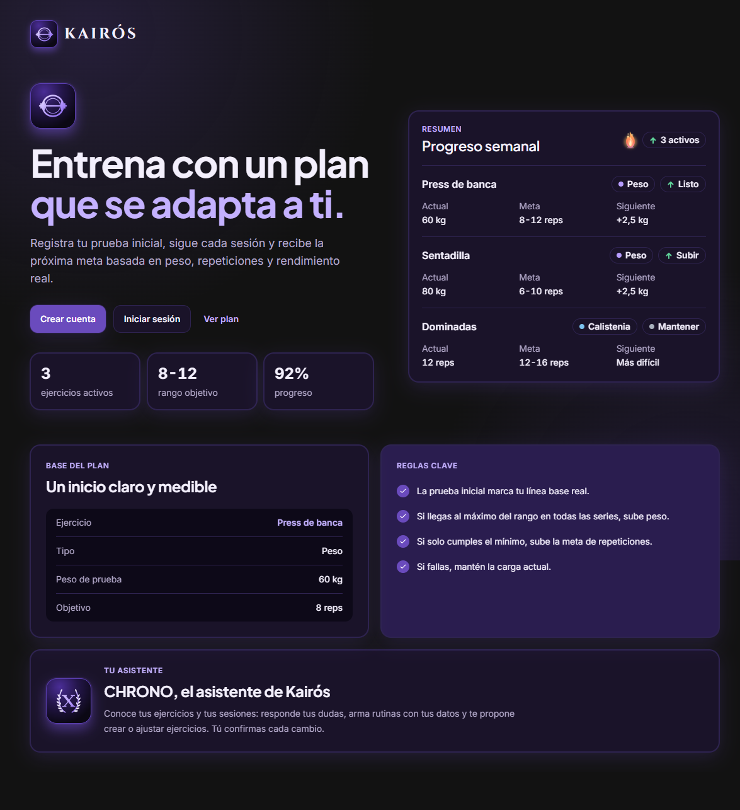

*Captura 1. Portada pública de Vercel, 25 de noviembre de 2026. La tarjeta de progreso es ilustrativa.*

En **Iniciar sesión**, la persona escribe su correo y contraseña. Desde allí puede crear una cuenta, recuperar la contraseña o cambiarla.

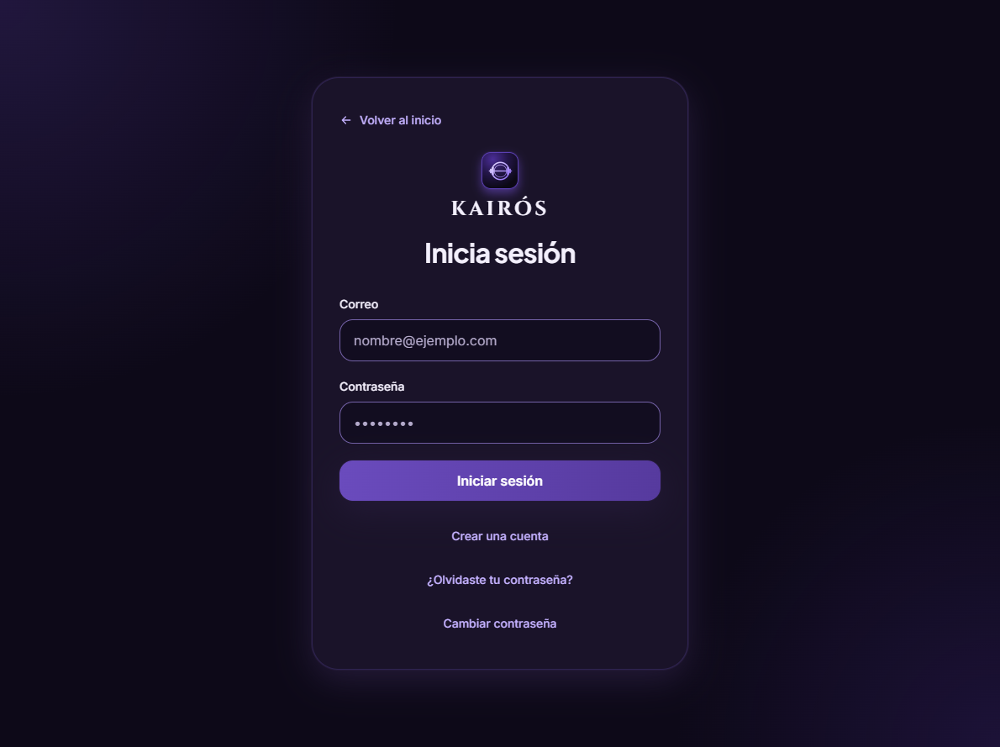

*Captura 2. Formulario público de inicio de sesión. No contiene credenciales.*

El **registro** tiene dos pasos. El primero solicita nombre, apodo opcional, fecha de nacimiento, género y días de entrenamiento. El segundo solicita los datos de acceso; después se confirma la cuenta mediante el enlace enviado por correo. Las cuentas de menores de 12 años requieren autorización de su tutor.

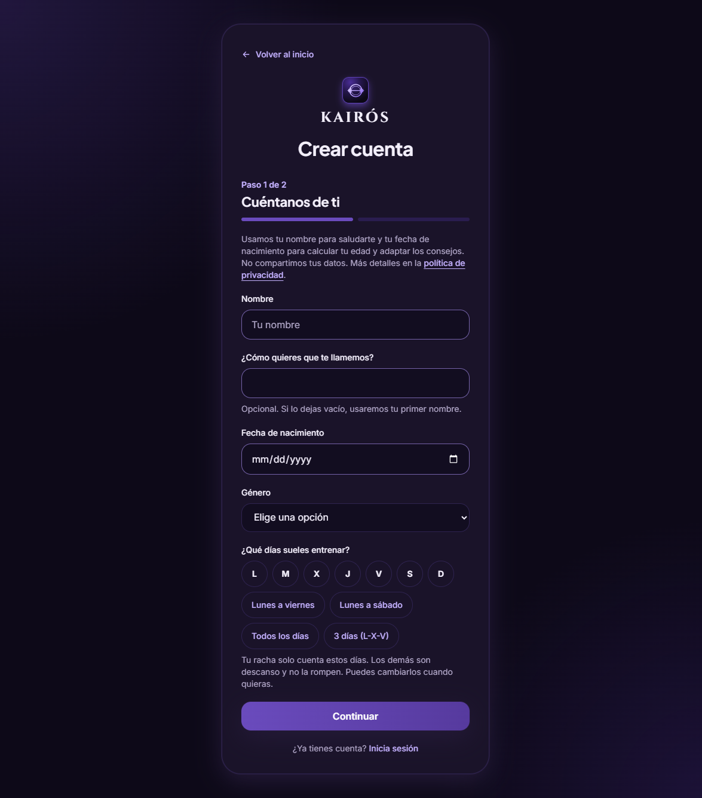

*Captura 3. Primer paso del registro, vacío y sin datos personales.*

La pantalla **Recuperar contraseña** solicita el correo y envía un enlace de un solo uso para restablecerla.

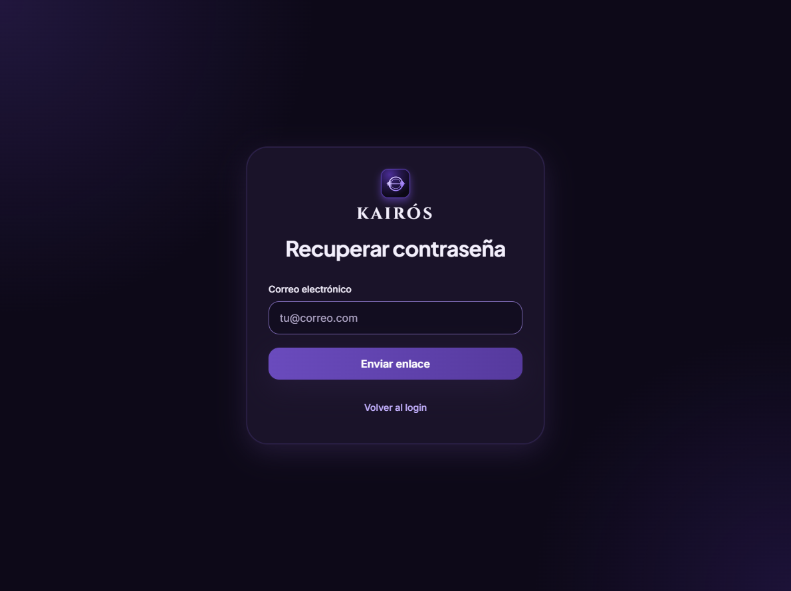

*Captura 4. Formulario público de recuperación de contraseña.*

La **política de privacidad**, enlazada desde el registro, explica qué datos se usan, cómo se tratan los mensajes de CHRONO y cómo solicitar correcciones o eliminación de la cuenta. Está publicada en [/privacidad](https://gymassistant-five.vercel.app/privacidad).

### Gimnasio, ejercicios y sesiones

Las siguientes pantallas requieren iniciar sesión. Las capturas 5–11 se tomaron el 22 de noviembre de 2026 con cuentas temporales y datos ficticios. El encabezado conserva la marca anterior, **Gym Assistant**; el nombre vigente de la aplicación es Kairós. No se incluyen correos, contraseñas ni identificadores de cuenta.

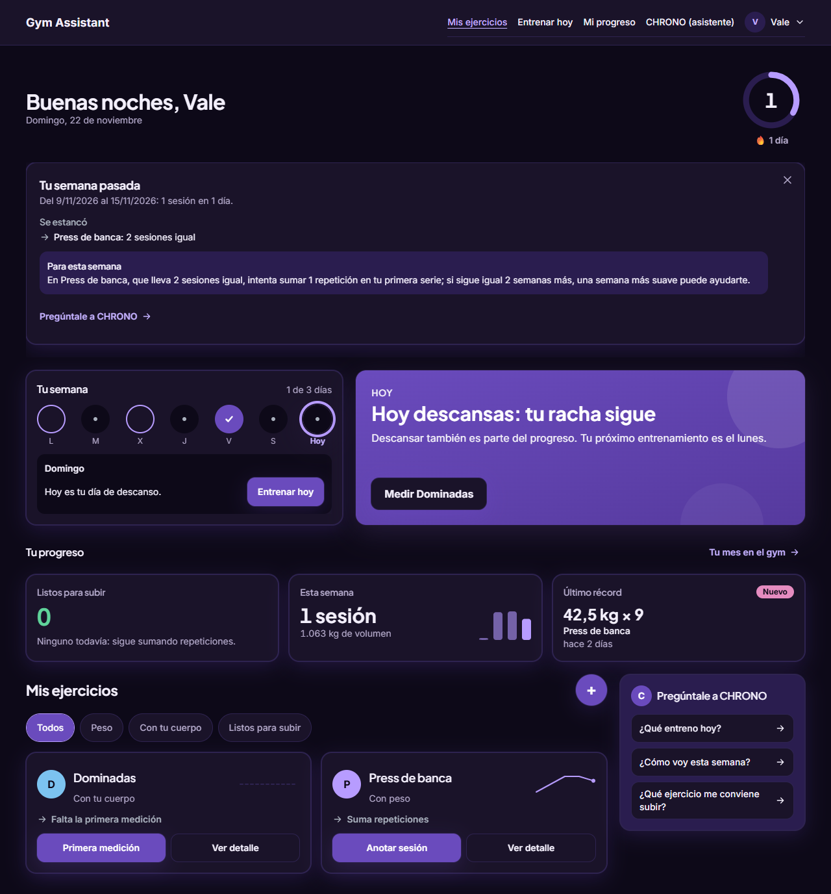

*Captura 5. Inicio del gimnasio: racha, resumen de la semana, recomendaciones y ejercicios. Datos ficticios; encabezado de la marca anterior.*

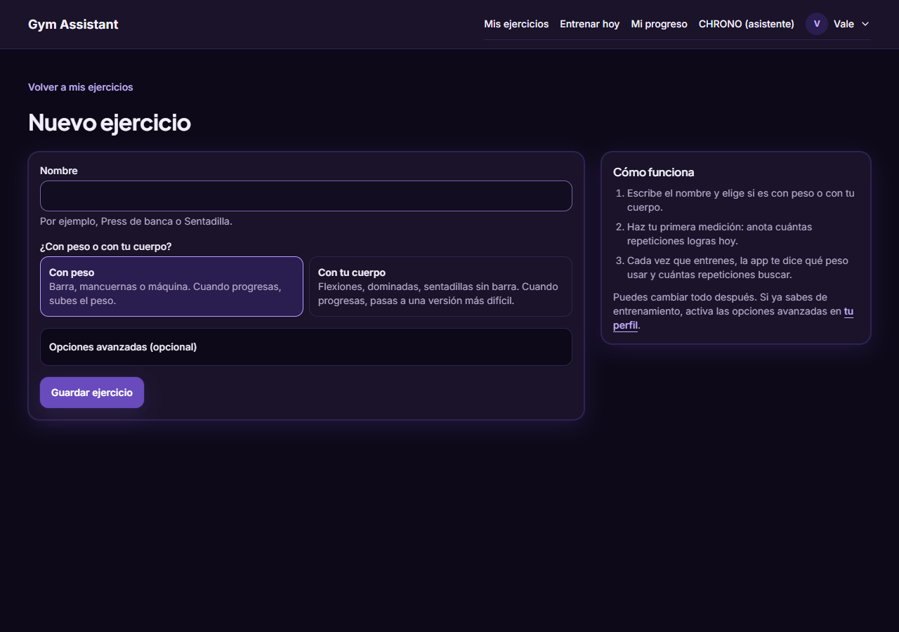

*Captura 6. Creación de ejercicio con peso o con el propio cuerpo. El formulario está vacío.*

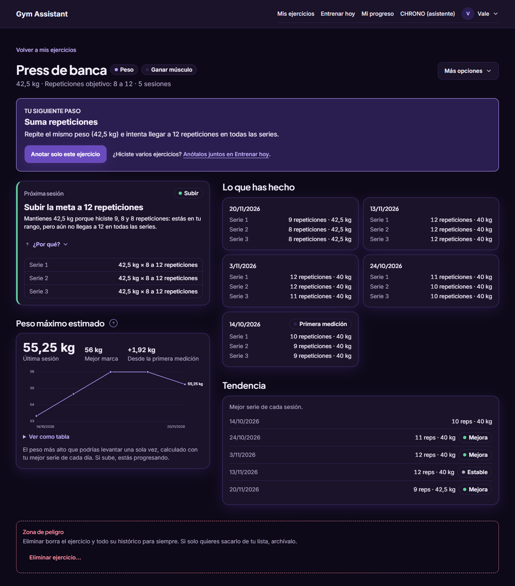

*Captura 7. Detalle de un ejercicio: siguiente paso, explicación, sesiones anteriores y tendencia.*

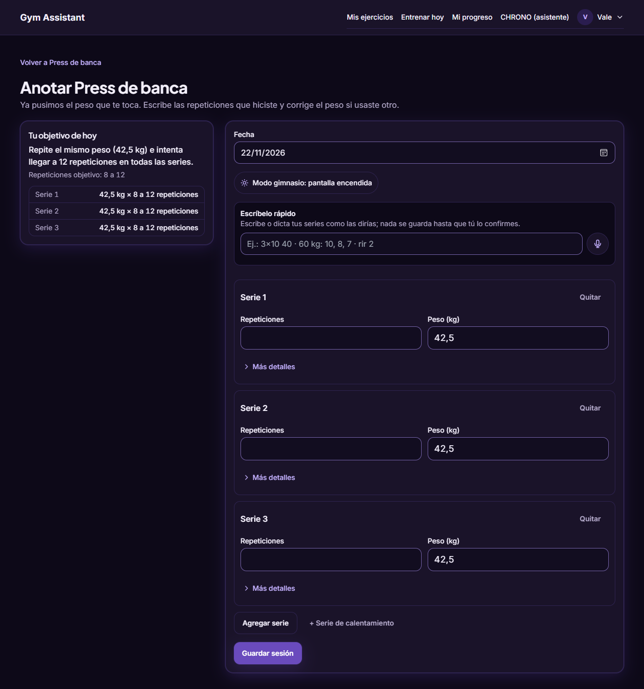

*Captura 8. Registro de sesión con objetivo, series y entrada rápida; los campos de repeticiones están vacíos.*

### Seguimiento y asistencia

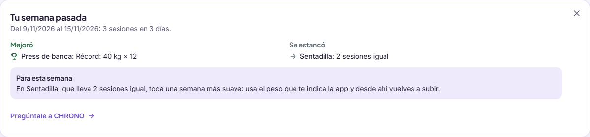

*Captura 9. Resumen semanal con mejoras, estancamientos y una sugerencia para la semana siguiente.*

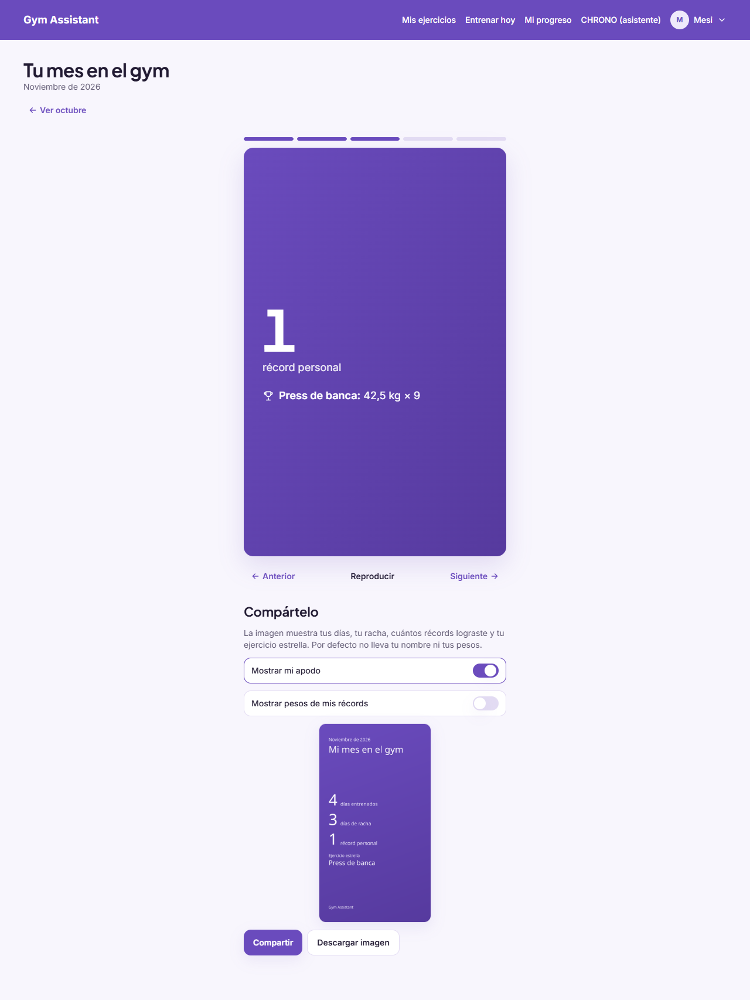

*Captura 10. Historia mensual con récords y controles de privacidad para compartir.*

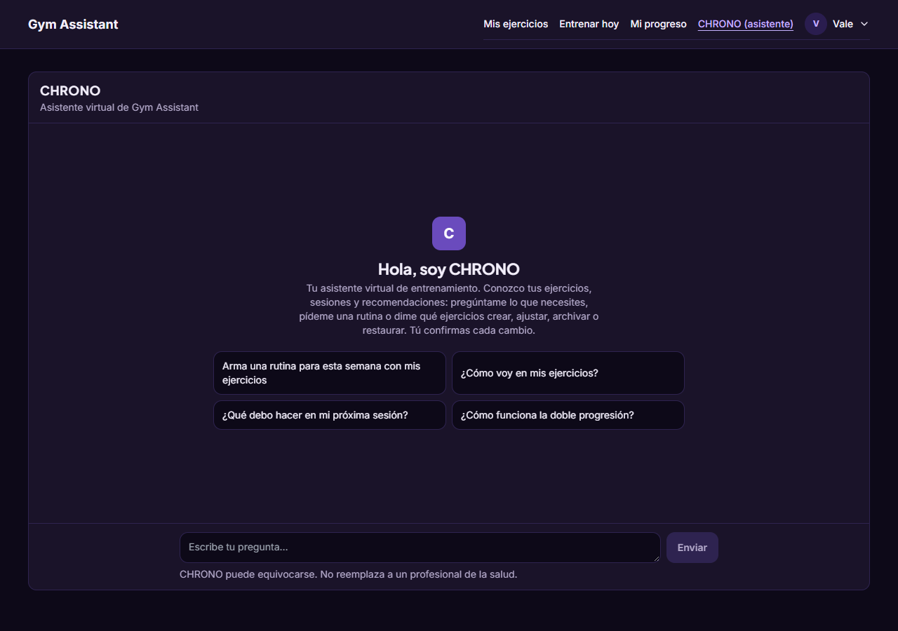

*Captura 11. Estado inicial de CHRONO y preguntas sugeridas. La conversación no se guarda en el servidor.*

| Pantalla | Qué permite hacer |
|---|---|
| **Inicio del gimnasio** (`/gym`) | Revisar el saludo, la racha, el estado del día, el resumen de ejercicios y las recomendaciones; comenzar la guía o abrir las secciones del menú. |
| **Crear ejercicio** (`/gym/ejercicios/nuevo`) | Registrar un ejercicio con peso o de calistenia, elegir enfoque, rango y método de series. |
| **Prueba inicial** (`/gym/ejercicios/[id]/prueba`) | Anotar las series que fijan el punto de partida. Solo se permite una prueba inicial por ejercicio. |
| **Detalle del ejercicio** (`/gym/ejercicios/[id]`) | Consultar la recomendación y su explicación, las últimas sesiones, el historial y la evolución del 1RM estimado cuando corresponde. También permite cambiar enfoque o variante y archivar o restaurar el ejercicio. |
| **Registrar sesión** (`/gym/ejercicios/[id]/sesion`) | Anotar las series de un ejercicio. Al cumplir la meta, la aplicación muestra el resumen y el siguiente objetivo. Las sesiones y sus series no se editan ni eliminan individualmente. |
| **Entrenar hoy** (`/gym/entrenamiento`) | Registrar varios ejercicios en una misma visita. |
| **Resumen** (`/gym/resumen`) | Revisar un periodo de entrenamiento y el progreso de cada ejercicio. |
| **Perfil** (`/gym/perfil`) | Gestionar datos del perfil, días de entrenamiento, modo sencillo o avanzado, foto, récords, totales y racha. |
| **CHRONO** (`/gym/chat`) | Preguntar sobre el entrenamiento y solicitar rutinas. Puede proponer crear o ajustar ejercicios; la persona confirma o cancela cada propuesta. |
| **Tu mes en el gym** (`/gym/mi-mes`) y **Museo** (`/gym/museo`) | Ver resúmenes visuales, actividad y récords mensuales; generar una imagen para compartir con controles de privacidad. |

## 4. Tecnologías y por qué se eligieron

- **Next.js App Router y React:** páginas públicas y privadas, renderizado en servidor y rutas de API en una sola aplicación.
- **TypeScript:** define contratos y tipos para formularios, datos y reglas, reduciendo errores en cambios futuros.
- **Tailwind CSS:** permite construir una interfaz consistente y adaptable a móvil sin sumar una biblioteca de componentes.
- **Supabase Auth y Supabase Postgres:** resuelven la autenticación y la persistencia administrada en internet.
- **`pg`:** las consultas del servidor usan PostgreSQL y permiten guardar una sesión con sus series dentro de una transacción.
- **Zod:** valida los datos recibidos antes de procesarlos.
- **Vitest:** prueba las reglas de negocio puras y los flujos de la aplicación.
- **Vercel:** publica la aplicación Next.js y su API.
- **Groq:** procesa las respuestas de CHRONO cuando la integración está configurada y disponible.

## 5. Login y almacenamiento de datos

El login usa Supabase Auth con correo y contraseña. La sesión se mantiene en cookies para que las páginas y rutas del servidor puedan comprobarla. `/gym` y las API del gimnasio exigen una sesión válida.

Los ejercicios, sesiones y series se guardan en Supabase Postgres; las fotos de perfil se guardan en un almacenamiento privado de Supabase. Las rutas del servidor obtienen el identificador de la cuenta desde la sesión, no desde un dato enviado por el navegador. Las consultas filtran por ese identificador para que cada cuenta acceda únicamente a sus propios datos. Las tablas de la aplicación tienen RLS activo y no conceden acceso directo a los roles públicos de cliente; las operaciones pasan por el servidor.

Las conversaciones de CHRONO se conservan en la pestaña del navegador. Para responder, se envían a Groq el mensaje y los datos de entrenamiento necesarios. CHRONO no recibe la fecha de nacimiento, el correo ni la foto del perfil. Las propuestas de cambios no se aplican hasta que la persona las confirma.

## 6. Qué quedó fuera y qué podría seguir

Kairós no es una plataforma para administrar entrenadores y clientes, no calcula nutrición ni composición corporal, no integra wearables y no ofrece diagnóstico o tratamiento médico. Tampoco reemplaza el criterio profesional. Las sesiones y series son un historial inmutable; para corregir un registro se crea una nueva sesión. CHRONO depende de un servicio externo y de sus límites de disponibilidad y uso.

Con más tiempo, los siguientes pasos serían:

1. Actualizar las capturas si cambia la interfaz, manteniendo cuentas y datos ficticios.
2. Revisar el recorrido completo con la cuenta demo desde una ventana de incógnito antes de entregar.
3. Seguir mejorando la experiencia móvil, la guía y la claridad de los resúmenes.
4. Evaluar integraciones adicionales solo después de validar su utilidad, privacidad y costo.

## 7. Cómo revisar la entrega

- **Aplicación:** [https://gymassistant-five.vercel.app](https://gymassistant-five.vercel.app)
- **Inicio de sesión:** [https://gymassistant-five.vercel.app/login](https://gymassistant-five.vercel.app/login)
- **Repositorio público:** [https://github.com/Shantiago-bit/GYM.assistant](https://github.com/Shantiago-bit/GYM.assistant)
- **Cuenta demo:** sus credenciales se entregan por separado en el campo de comentario de la plataforma; no se incluyen en este documento ni en el repositorio.

Antes de entregar, abre la aplicación en incógnito, inicia sesión con la cuenta demo y confirma que puedes llegar a `/gym`. Las capturas públicas se tomaron de Vercel; las autenticadas muestran cuentas temporales y datos ficticios. No se publican credenciales, correos ni identificadores de cuenta.
